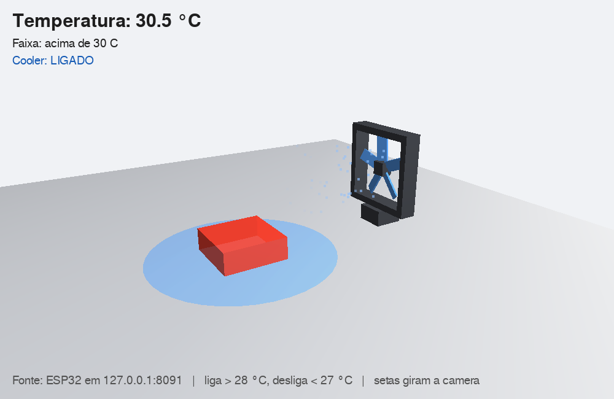
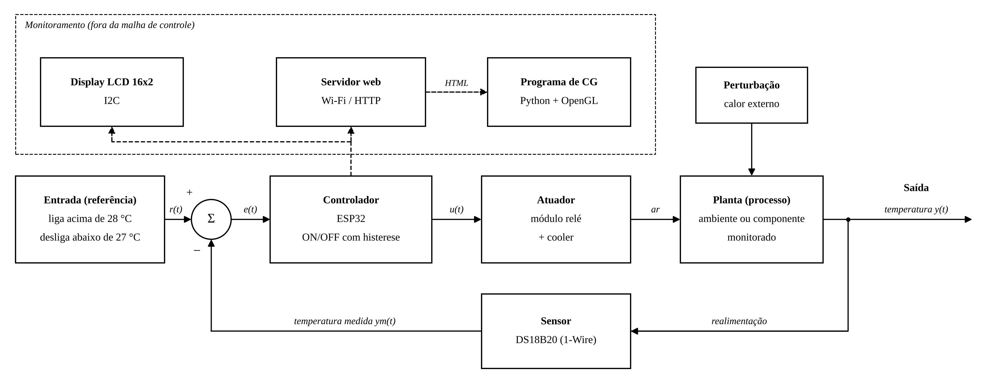

# Monitoramento de temperatura com ESP32

Projeto Integrador do 8º semestre de Engenharia de Computação (UNASP).

O ESP32 lê a temperatura em um sensor DS18B20 e liga um cooler quando ela passa de um limite, usando controle ON/OFF com histerese. Os valores aparecem num display LCD, numa página web servida pelo próprio ESP32 e no broker MQTT da Raspberry Pi. Um programa de computação gráfica em Python lê essa página continuamente e representa a temperatura numa cena 3D.



## Diagrama de blocos



Malha fechada: a referência (liga acima de 28 °C, desliga abaixo de 27 °C) é comparada com a temperatura medida; o ESP32 decide o estado do relé, que aciona o cooler; o cooler retira calor da planta; o DS18B20 fecha a realimentação. O LCD, o servidor web e o programa gráfico apenas monitoram e ficam fora da malha. Versão em PDF: [docs/diagrama_de_blocos.pdf](docs/diagrama_de_blocos.pdf).

## Controle com histerese

Com um limite só, o ruído da leitura perto dele faria o relé ligar e desligar várias vezes seguidas. Com dois limites, entre 27 °C e 28 °C o estado anterior é mantido: o cooler liga acima de 28 °C e só desliga abaixo de 27 °C. Uma faixa mais larga reduz as comutações do relé e aumenta a oscilação da temperatura.

Os limites são o **alvo ± 0,5 °C**. O alvo padrão é 27,5 °C, o que dá os mesmos 28 °C e 27 °C, e pode ser mudado por MQTT (veja [Comandos](#comandos)). Sem leitura do sensor o cooler desliga em qualquer modo.

## Componentes e ligações

| Componente | Pino do ESP32 | Observação |
|---|---|---|
| DS18B20 (DATA) | GPIO 23 | Resistor de 4,7 kΩ entre DATA e 3,3 V |
| Módulo relé (IN) | GPIO 26 | Módulo ativo em nível baixo; ajustar `RELE_LIGADO` se for ativo em alto |
| LCD 16x2 I2C (SDA / SCL) | GPIO 21 / GPIO 22 | Endereço 0x27 (alguns módulos usam 0x3F) |
| Cooler | Contato do relé | Alimentado por fonte própria |

Os GPIO 34 a 39 do ESP32 são somente entrada e não servem para acionar o relé.

## Firmware

Pasta `firmware/`, projeto PlatformIO.

1. Copie `include/secrets.h.example` para `include/secrets.h` e preencha o nome e a senha da rede Wi-Fi e a senha do usuário `esp32` do broker (a mesma do `infra/raspberry-pi/.env`). Esse arquivo fica fora do git. Um `secrets.h` antigo, sem os dados do MQTT, interrompe a compilação com uma mensagem pedindo para completá-lo.
2. Compile e grave pelo PlatformIO no VS Code, ou pelo terminal:

```
pio run -d firmware -t upload
pio device monitor -d firmware
```

Ao conectar, o ESP32 mostra o próprio IP no LCD e no monitor serial. Sem Wi-Fi ou sem broker, o controle do cooler continua funcionando.

Rotas HTTP:

| Rota | Retorno |
|---|---|
| `/` | Página com temperatura em °C e °F e estado do cooler, já preenchidos |
| `/temperaturec` | Temperatura em °C (texto) |
| `/temperaturef` | Temperatura em °F (texto) |
| `/status` | `LIGADO` ou `DESLIGADO` |

### MQTT

O ESP32 publica no Mosquitto da Raspberry Pi ([infra/raspberry-pi](../../infra/raspberry-pi/README.md)) com o usuário `esp32`. Ele procura a Pi pelo nome `rasp400.local` e, se o mDNS não responder, usa o `MQTT_HOST_IP` do `secrets.h`. Se a conexão cair, tenta de novo a cada 15 s.

| Tópico | Conteúdo | Retido |
|---|---|---|
| `pi-temperatura/esp32/leitura` | JSON a cada leitura (2 s) | sim |
| `pi-temperatura/esp32/status` | `online` ao conectar, `offline` pelo Last Will | sim |
| `pi-temperatura/esp32/evento` | `{"evento":"pronto","reinicio":"ligada"}` a cada conexão ao broker, `{"evento":"teste"}` e `{"erro":"..."}` | não |
| `pi-temperatura/esp32/comando` | o ESP32 **assina**; ordens em texto, uma por mensagem | não |

```json
{"ts":1730000000,"temperatura_c":27.31,"cooler":true,"alvo":27.5,"modo":"auto"}
```

- `ts`: horário Unix em segundos (UTC), do NTP. Vale `null` enquanto o ESP32 não sincroniza, por exemplo numa rede sem internet.
- `temperatura_c`: °C com duas casas. Vale `null` com falha no sensor, e nesse caso `cooler` vem `false`.
- `cooler`: estado do relé.
- `alvo`: temperatura desejada em °C. `modo`: `auto`, `resfriar`, `aquecer`, `desl` ou `manual`.
- `reinicio` (no evento `pronto`): por que o ESP32 iniciou (`ligada`, `brownout`, `watchdog`, `software`...). `brownout` é falta de energia, por exemplo o cooler puxando corrente da mesma USB.

A leitura é retida para que um programa que assine depois receba na hora o último valor. Para saber se esse valor ainda é atual, use `ts` ou o tópico `status`. Os campos `alvo` e `modo` foram acrescentados depois de `cooler`, sem mudar os três primeiros.

#### Comandos

Publique em `pi-temperatura/esp32/comando`, **sem retain**: um comando retido seria repetido a cada reconexão. Maiúsculas e minúsculas tanto faz, e o alvo aceita vírgula (`ALVO 26,5`). Depois de cada comando a leitura é publicada na hora.

| Comando | Efeito |
|---|---|
| `ALVO 26.5` | Alvo de 10 a 40 °C (valores fora da faixa são limitados) |
| `MODO AUTO` / `MODO RESFRIAR` | Cooler liga e desliga em volta do alvo |
| `MODO AQUECER` | Não há aquecedor: o cooler desliga e a sala esquenta sozinha |
| `MODO DESL` | Cooler desligado |
| `COOLER LIGA` / `COOLER DESLIGA` | Liga ou desliga na mão (modo `manual`). `SERVO 0..89` liga e `SERVO 90..180` desliga |
| `TESTE` | Liga o cooler por 1 s e volta ao estado anterior |
| `KP x`, `KI x` | Aceitos e ignorados (o controle é ON/OFF, sem PI) |
| `?` | Publica a leitura na hora |

Comando que não existe ou `ALVO` sem número vira `{"erro":"comando invalido: ..."}` no tópico `evento`.

O alvo e o modo voltam ao padrão (27,5 °C, `auto`) se o ESP32 reiniciar. Quem manda as ordens, como o assistente Cozmo, deve reenviá-las ao ver `online` no `status` ou o evento `pronto`.

```bash
mosquitto_pub -h 192.168.1.214 -u colega -P "$MQTT_PASS_COLEGA" -t pi-temperatura/esp32/comando -m 'ALVO 25'
```

O broker ainda não tem ACL (veja [infra/raspberry-pi](../../infra/raspberry-pi/README.md#observações-de-segurança)): qualquer usuário autenticado pode publicar nesse tópico.

Para acompanhar do notebook (WSL, na raiz do repositório), com o usuário `logger` do `.env`:

```bash
set -a; . infra/raspberry-pi/.env; set +a
mosquitto_sub -h 192.168.1.214 -u logger -P "$MQTT_PASS_LOGGER" -t 'pi-temperatura/esp32/#' -v
```

A linha serial (`Temperatura: 27.31 C | Cooler: LIGADO`) e as rotas HTTP continuam iguais. O ESP32 também responde pelo nome `pi-temperatura-esp32.local`.

## Programa de computação gráfica

Pasta `computacao_grafica/`. Faz uma requisição HTTP à página do ESP32 a cada 2 segundos e extrai os valores com BeautifulSoup. A cena, feita com Pygame e OpenGL, mostra um cubo de gelo que derrete e muda de cor conforme a faixa de temperatura, e um cooler que gira quando o relé está ligado.

```
pip install -r computacao_grafica/requirements.txt
python computacao_grafica/temperatura_cg.py --ip 192.168.0.50
python computacao_grafica/temperatura_cg.py --simular
```

O modo `--simular` gera uma temperatura oscilante com a mesma histerese e dispensa o hardware. As setas giram a câmera e ESC fecha.

## Estrutura

```
pi-temperatura/
├── firmware/              projeto PlatformIO do ESP32
├── computacao_grafica/    visualização 3D em Python
└── docs/                  diagrama de blocos e captura de tela
```
