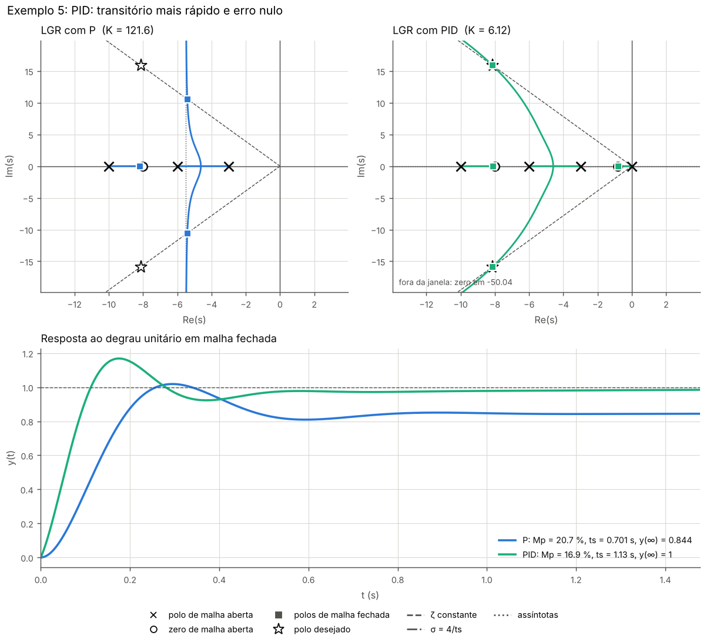

# Projeto de controladores P, PI e PID pelo Lugar Geométrico das Raízes

Sistemas de Controle, Engenharia de Computação (UNASP).

Programa em Python que projeta controladores P, PI e PID usando só o método do Lugar Geométrico das Raízes (LGR): a partir da planta `G(s)` e dos requisitos de resposta (sobressinal, tempo de acomodação, tempo de pico), ele calcula o polo desejado, aplica as condições de ângulo e de módulo, mostra o passo a passo das contas e confere o resultado simulando a malha fechada.

O LGR, as regras de esboço e os projetos são calculados no próprio código, com `numpy` e `scipy`, sem a biblioteca `control`. Assim cada conta da teoria tem uma função correspondente para ler e conferir. O guia de estudo está em [docs/teoria.md](docs/teoria.md).



## Instalação

Python 3.10 ou mais novo.

```bash
cd SistemasDeControle/lgr-controladores
python -m venv .venv
```

Ative o ambiente (`source .venv/bin/activate` no Linux e no macOS, `.venv\Scripts\activate` no Windows) e instale as dependências:

```bash
pip install -r requirements.txt
```

## Uso

### Exemplos para estudar

```bash
python exemplos.py --listar
python exemplos.py
python exemplos.py 3
```

Cada exemplo imprime o relatório e grava a figura e o texto em `saidas/` (pasta fora do git). Os exemplos vêm dos livros do Ogata e do Nise, para dar para conferir com a resolução do livro.

| # | Assunto | Planta |
|---|---|---|
| 1 | Regras de esboço do LGR | `1/(s(s+1)(s+2))` |
| 2 | P: ajuste de ganho para ζ = 0,174 | `1/((s+1)(s+2)(s+10))` |
| 3 | PI ideal: zera o erro sem mudar o transitório | mesma do 2 |
| 4 | PI pela condição de ângulo | mesma do 2, Mp = 20 % e ts = 4 s |
| 5 | PID: mais rápido e com erro nulo | `(s+8)/((s+3)(s+6)(s+10))`, Mp = 20 % e tp = 0,198 s |

### Projeto para uma planta qualquer

A planta pode ser dada por coeficientes (potências decrescentes de s, como no MATLAB):

```bash
python projetar.py --num 1 8 --den 1 19 108 180 --sobressinal 20 --tp 0.198
```

ou por polos, zeros e ganho:

```bash
python projetar.py --zeros -8 --polos -3 -6 -10 --sobressinal 20 --tp 0.198
```

Polos complexos são escritos como `-1+2j`.

Opções principais:

| Opção | Significado |
|---|---|
| `--sobressinal`, `--zeta` | Amortecimento: sobressinal em % ou ζ direto |
| `--ts`, `--tp`, `--wn` | Requisito de tempo: acomodação (2 %), pico ou frequência natural |
| `-c p`, `-c pi`, `-c pid`, `-c todos` | Quais controladores projetar (padrão: todos) |
| `--metodo-pi angulo` ou `ideal` | PI pela condição de ângulo (polo exato) ou como compensação integral ideal |
| `--zero-pi 0.1` | Posição do zero integral `(s + z)` no PI ideal e no PID |
| `--salvar figura.png` | Grava a figura |
| `--sem-janela` | Não abre a janela do gráfico |
| `--sem-regras` | Não imprime as regras de esboço |

O P precisa de um requisito só (ζ ou ts). O PI pela condição de ângulo e o PID precisam de dois, porque posicionam o polo num ponto exato do plano s. Com mais de dois requisitos o programa recusa, já que um ponto no plano tem só duas coordenadas.

### O que sai no relatório

1. A planta e as regras do LGR: ramos, trechos do eixo real, assíntotas, pontos de separação, cruzamento do eixo jω, ângulos de partida e faixa de K estável.
2. Para cada controlador, o passo a passo do projeto: deficiência angular, ângulo que cada zero precisa dar, posição dos zeros e ganho pela condição de módulo.
3. O controlador na forma de polos e zeros, `C(s) = K (s + zi)(s + zd)/s`, e na forma paralela `Kp`, `Ki` e `Kd`.
4. A verificação: polos de malha fechada, previsto pela 2ª ordem contra o simulado, erro em regime e avisos quando a hipótese de polos dominantes não vale.

Quando o requisito não pode ser atendido com aquele controlador, o relatório diz por quê. Por exemplo: o LGR do P não cruza a reta de ζ, ou o zero do PI precisaria ficar no semiplano direito.

### Uso como biblioteca

```python
from lgr import FuncaoTransferencia, Requisitos, projetar_pid, verificar

G = FuncaoTransferencia([1, 8], [1, 19, 108, 180])
req = Requisitos.de(sobressinal=20, tp=0.198)
c = projetar_pid(G, req)
print(c.descrever())
print(c.ganhos_paralelos)   # (Kp, Ki, Kd)
v = verificar(c.ft, G, c.polo_projetado)
print(v.metricas)
```

## Estrutura

| Arquivo | Conteúdo |
|---|---|
| `lgr/especificacoes.py` | Sobressinal ↔ ζ, ts → σ, tp → ωd, polo desejado |
| `lgr/funcao_transferencia.py` | Classe `FuncaoTransferencia` (N(s)/D(s), polos, zeros, malha fechada) |
| `lgr/lugar_raizes.py` | Condições de ângulo e módulo, interseção do LGR com retas, regras de esboço, traçado dos ramos |
| `lgr/projeto.py` | `projetar_p`, `projetar_pi`, `projetar_pid` |
| `lgr/analise.py` | Resposta ao degrau, métricas, erro em regime, dominância dos polos |
| `lgr/graficos.py` | Gráficos do LGR e da resposta ao degrau |
| `lgr/relatorio.py` | Relatório em texto |
| `projetar.py` | Linha de comando |
| `exemplos.py` | Exemplos de estudo |
| `tests/` | Testes com os valores dos livros (`python -m pytest tests`) |
| `docs/teoria.md` | Guia de estudo: LGR, regras, requisitos, P, PI e PID |

## Limitações

- Realimentação unitária. Com sensor `H(s)` na realimentação, o LGR é o de `C(s)G(s)H(s)`, mas o erro em regime e a resposta mudam; ainda não está implementado.
- Só ganho `K > 0` (LGR de 180°). Uma planta com ganho negativo, como o cooler do [Projeto Integrador](../../Embarcados/pi-temperatura), que resfria, precisa ser projetada com `−G(s)` e com o sinal dos ganhos invertido no fim.
- Atraso de transporte (`e^(−θs)`) não é tratado diretamente; pode ser aproximado por Padé antes de entrar no programa.
- Os requisitos de tempo usam a aproximação de 2ª ordem. Por isso todo projeto é simulado e o relatório compara previsto com simulado.
